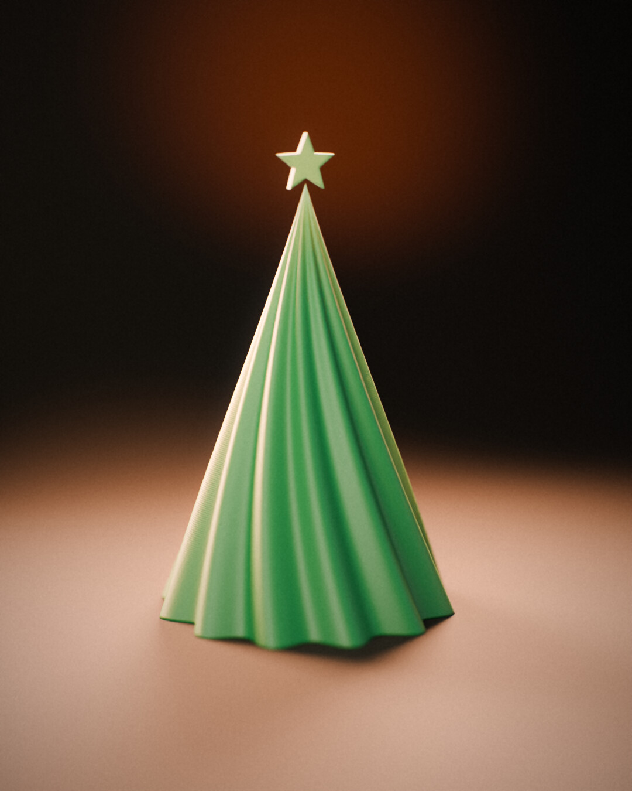

# Poster Studio (Blender 5.3)

Turns a 3D model into a realistic product photo for Instagram and TikTok. It builds a photo
studio in Blender, renders with Cycles, then applies a camera "realistic filter".



## Setup (once)

1. Install **Blender 5.3** from blender.org. On Windows it goes to
   `C:\Program Files\Blender Foundation\Blender 5.3\`. If yours is somewhere else, edit the
   `BLENDER=` line at the top of `render.bat`.
2. Put your models in `poster-studio/models/` (`.stl`, `.obj`, `.glb`, `.gltf`, `.ply`, `.fbx`, `.blend`).

You don't need to install anything else. The script only uses what comes with Blender.

## Render

Open a terminal in `poster-studio` and run:

```
render.bat configs\example-dark-glow.json --preview    (fast check, ~10 s)
render.bat configs\example-dark-glow.json              (full quality)
```

Results go to `poster-studio/renders/`:

| File | What it is |
|---|---|
| `name_feed.png` | Final poster with the realistic filter (1080×1350) |
| `name_story.png` | 9:16 version for TikTok, Reels and Stories (1080×1920) |
| `name_feed_raw.png` | The clean render without the filter |
| `name_feed.blend` | The scene, so you can open it in Blender and tweak it by hand |

The script uses your GPU automatically (NVIDIA, AMD, Intel or Apple). Without one it renders on
the CPU, where a full-quality poster takes a few minutes.

## Christmas scene

Set `"scene": { "preset": "christmas" }` in a config, or start from `configs/christmas.json`.
The product sits on a lacquered rosewood table in a decorated living room:

- **Room:** the `christmas_photo_studio_01` 360° photo from Poly Haven. It shows behind the product, blurred, and also lights the scene.
- **Christmas tree:** in the background, with warm string lights, red, gold and silver baubles, and a star. Its lights blur into soft dots.
- **Vintage TV:** a CRT with a glowing screen. Set `"tv_image"` to put your logo or a poster on the screen.
- **Candlesticks:** two of them, with real flames that give off warm light.
- **Gifts:** wrapped boxes with ribbons and bows, sized to the product. Change their colours with `gift_colors`.
- **Snow and fairy lights:** falling snow and blurred fairy lights in the far background. The snow is kept away from the area in front of the product.

Scene options, all inside `"scene"`:
- `hdri`: the background room. You can use any Poly Haven HDRI name.
- `hdri_strength`: how bright the room is.
- `hdri_rotation_deg`: turns the room behind the product.
- `table_texture`: any Poly Haven wood texture name.
- `tree`, `tv`, `candles`, `gifts`: set any of them to `false` to remove that prop.
- `tv_image`: picture to show on the TV screen.
- `snow`: number of snowflakes. `0` turns it off.
- `bokeh_lights`: number of far fairy lights.
- `seed`: change it to shuffle where the snow and tree decorations land.

**Assets:** the TV, candlestick, HDRI and wood texture are free CC0 assets from
[Poly Haven](https://polyhaven.com), fine for commercial use with no credit needed. They
download automatically into `poster-studio/assets/` (about 45 MB) the first time you render
the scene. You can also download them yourself with `python fetch_assets.py`.

## Config

Copy an example in `configs/` and change it. Anything you leave out uses the default.

**Output**
- `name`: start of the file names
- `formats`: any of `feed` (4:5), `story` (9:16), `square` (1:1)
- `samples`: quality. 256 is clean; 128 is faster.

**Models** (a list, so you can put several products in one shot)
- `path`: model file, relative to the config file. Leave it empty to render the demo spiral tree.
- `height_cm`: real-world height. The model is scaled to this and stood on the floor.
- `position_cm`: `[x, y]` to place several models side by side.
- `rotation_deg`: turn the model to face the camera.
- `material`:
  - `pla_matte`: normal printed plastic
  - `pla_silk`: shiny silk filament
  - `resin`: smooth resin print
  - `keep`: use the colours already in the file, for example a painted `.glb`
- `color`: hex colour of the filament.
- `layer_height_mm` and `layer_lines`: the visible print layers. Set `layer_lines` to `0` to turn them off.

**Lighting**
- `preset`:
  - `dark_glow`: dark set with a warm halo behind the product, like the shop's catalogue photos
  - `clean_white`: bright white studio
- `intensity`: overall brightness of the lights.
- `glow_color` and `rim_color`: colours of the halo and the edge lights.

**Camera**
- `elevation_deg`: how high the camera is. 0 is eye level, 30 looks down.
- `orbit_deg`: turns the camera around the product.
- `lens_mm`: 85 is a classic product lens. 50 is wider, 135 flatter.
- `fstop`: background blur. 2.8 is very blurry, 8 is sharp throughout.
- `fill`: how much of the frame the product fills, from 0.5 to 0.8.
- `shift_y`: moves the product up or down in the frame, which leaves room for text.

**Look** (the realistic filter)
- `look`: Blender's AgX contrast look. Options are `AgX - Base Contrast`, `AgX - Medium High Contrast` and `AgX - Punchy`.
- `exposure`: overall brightness in stops.
- `bloom`: soft glow around bright areas.
- `halation`: the warm red edge that film gives highlights.
- `chromatic_aberration`: slight colour fringing toward the edges, like a real lens.
- `vignette`: darker corners.
- `grain`: sensor or film grain.
- `warmth`: warm colour grade in the mid-tones.

Set any filter value to `0` to switch that effect off.

## Coming next

Overlays: product name, price, logo and call-to-action text on the poster, matching the
Christmas poster templates. More props: send model files and they can be added to the set.
